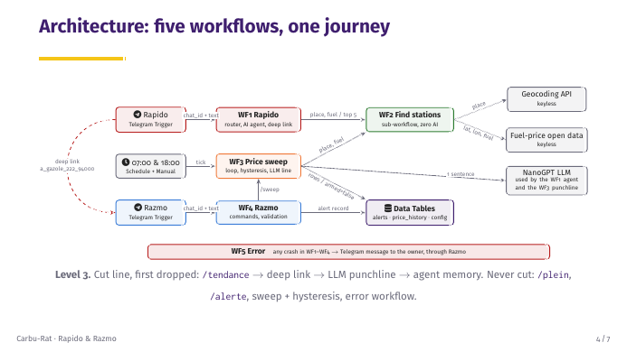
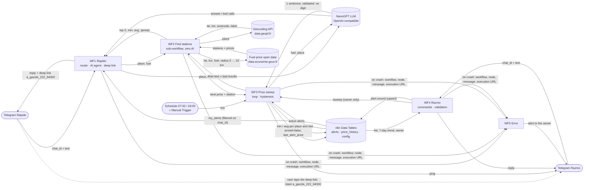
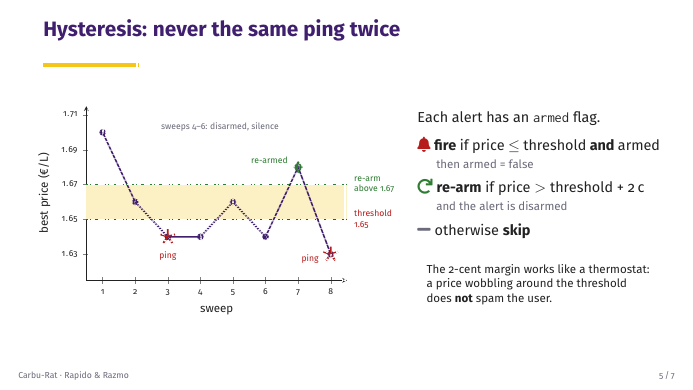
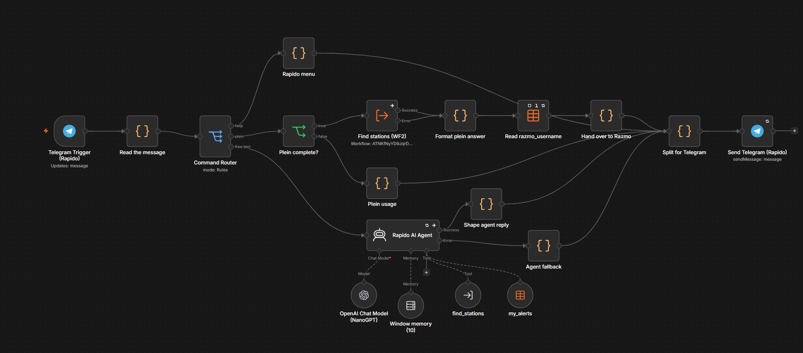
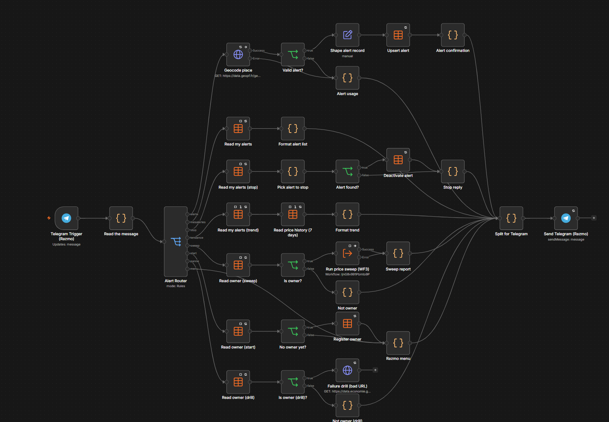
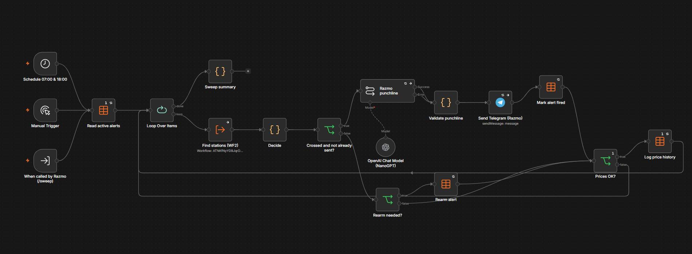
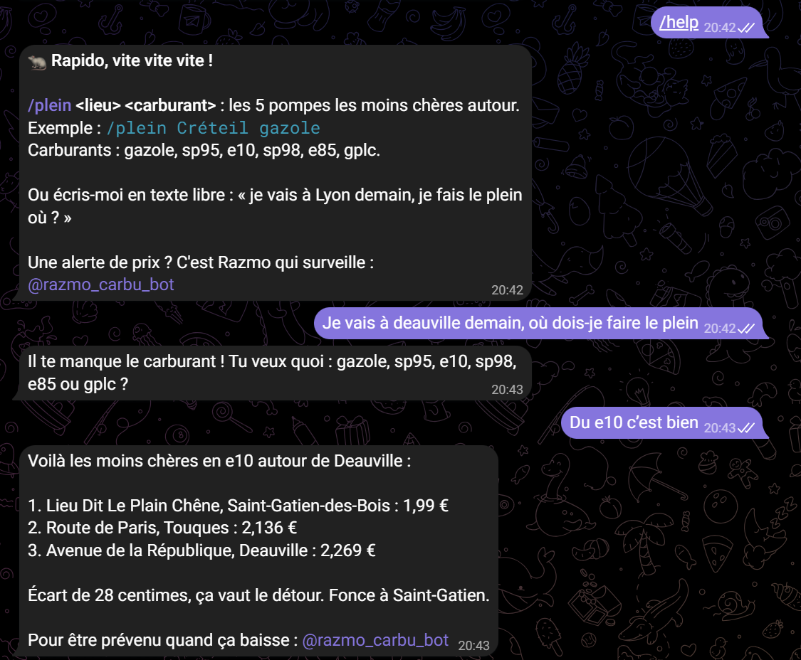

# Carbu-Rat · Rapido & Razmo, the fuel-price rats

Fuel-price assistant and threshold alerts on Telegram, built on n8n.
Josh E. SOUSSAN · October 2026 · **Level 3**

> **The need, in one sentence:** drivers in France pay up to 15–20 cents more per litre depending on the station, and today they check a price-comparison website by hand, when they remember to, without ever knowing when prices finally drop.

Two Telegram bots share the job:

| Bot | Role | Example |
|---|---|---|
| **Rapido** (@rapido_carbu_bot) | *Pull*: you ask, he answers. Five cheapest stations around a place, or a free-text question answered by an AI agent. | `/plein Créteil gazole` |
| **Razmo** (@razmo_carbu_bot) | *Push*: you give him a target price once; he checks the pumps twice a day and pings you only when the threshold is crossed, never twice for the same drop. | `/alerte gazole 1,65 Créteil` |

The LLM decides the tone, never the price: every number shown to the user comes from the open-data API and is formatted by a Code node.

---

## Architecture





### The five workflows (`workflows/`)

| File | Workflow | What it does |
|---|---|---|
| `Carbu_WF1_Rapido.json` | Telegram Trigger → `Read the message` (Code) → `Command Router` (Switch, 3 routes) | `/start` `/help` → static menu (0 LLM call). `/plein <place> <fuel>` → WF2 → formatted answer → `Hand over to Razmo` adds the deep link (threshold = best price − 3 c). Free text → `Rapido AI Agent` (NanoGPT, 10-message memory per chat, tools `find_stations` = WF2 and `my_alerts` = alerts table filtered on the chat). One shared `Send Telegram (Rapido)` node. |
| `Carbu_WF2_Find_stations.json` | Execute Workflow Trigger with declared inputs `{place, fuel}` | Normalise the fuel (diesel → gazole, 95 → sp95…) → Geocode → `Address found?` → prices within 5 km → fewer than 3 stations? once more at 10 km → `Rank & trim` → `{ok, place_label, postcode, lat, lon, stations[top 5], min, avg, spread, radius_km}` or `{ok:false, reason}`. |
| `Carbu_WF3_Price_sweep.json` | Schedule 07:00 & 18:00, Manual Trigger, Execute Workflow Trigger | Read active alerts → loop → WF2 → `Decide` (hysteresis) → `Crossed and not already sent?` → `Razmo punchline` (Basic LLM Chain) → `Validate punchline` (rejects digits, 10 template fallbacks) → ping → disarm → upsert `price_history`. |
| `Carbu_WF4_Razmo.json` | Telegram Trigger → `Read the message` → `Alert Router` (Switch) | `/alerte` and `/start a_…` → `Valid alert?` (known fuel, 0.50–3.50 €, place geocodes) → Set → upsert into `alerts`. `/mesalertes`, `/stop n`, `/tendance`, `/sweep` (owner), `/panne` (owner, failure drill), `/start` (first user becomes owner), anything else → menu. |
| `Carbu_WF5_Error.json` | Error Trigger | Reads `config.owner_chat_id` → Set `{workflow, node, message, execution_url}` → Telegram alert through Razmo. Set as error workflow of WF1–WF4. |
| `data-tables.json` | — | Schema of the three Data Tables and the rows of `config`. |

### Hysteresis: never the same ping twice



- **fire** if `min ≤ threshold` **and** `armed = true`, then `armed = false`;
- **re-arm** if `min > threshold + 0.02 €` **and** `armed = false`;
- otherwise **skip**. Running the sweep twice never sends the same ping twice.

### Level and cut line

Targeting **Level 3**. Cut line, in the order things would be dropped: `/tendance` and `price_history` → the Rapido-to-Razmo deep link → Razmo's LLM punchline (replaced by templates) → Rapido's conversation memory.
**Never cut:** Rapido's `/plein`, Razmo's `/alerte`, the sweep with its hysteresis, and the error workflow. Nothing was cut in this version.

### Robustness

| Requirement | Where |
|---|---|
| Retry on fail (3 tries, 2 s) | every HTTP Request, LLM, Telegram and Data Table node |
| Continue on error with an in-character fallback | geocoding / fuel API, AI agent, punchline chain, sub-workflow calls |
| Error workflow | WF5, linked in the settings of WF1–WF4 (and WF2); message contains workflow name, node, error and execution URL |
| Usage messages | `/plein` without place or fuel, unknown fuel, threshold out of range, unknown place, unknown command |
| Idempotency | sweep hysteresis (no duplicate ping), `price_history` upsert (no duplicate row), `/alerte` upsert on (chat, fuel, postcode) (no duplicate alert) |
| AI output validated | `Validate punchline`: empty, too long or containing a digit → one of 10 hand-written lines |
| Live failure test | `/panne` (owner only) calls a dataset that does not exist → WF4 fails → WF5 alerts the owner |
| Long messages | split under 4,000 characters before every Telegram send (HTML parse mode) |

---

## Setup: from clone to running

**Prerequisites:** Docker Desktop (or Docker Engine with Compose v2), Git Bash on Windows, two Telegram bots created with @BotFather, a NanoGPT API key.

```bash
git clone https://github.com/joshsssn/No-Code-Final-Project.git
cd No-Code-Final-Project
./start-carbu.sh          # Windows: double-click start-carbu.bat
```

`start-carbu.sh`:
1. creates `.env` from `.env.example` and generates `N8N_ENCRYPTION_KEY` if it is empty;
2. starts the Cloudflare tunnel and reads its public `https://*.trycloudflare.com` URL;
3. writes it as `WEBHOOK_URL` in `.env` (and in `logs/tunnel-url.txt`);
4. starts n8n and waits for its healthcheck (`/healthz`);
5. if `N8N_API_KEY` is set, deactivates and reactivates WF1 and WF4 so Telegram receives the new webhook URL.

Plain `docker compose up -d` also works; the bots then need a public `WEBHOOK_URL` in `.env`.
`./stop-carbu.sh` stops everything without deleting anything. The data lives in the named volume `carbu_n8n_data`, so it survives `docker compose down` / `up`.

Then, in n8n (http://localhost:5678):
1. Create the owner account, then **Settings > n8n API > Create API key** and put it in `.env` as `N8N_API_KEY`.
2. Create three credentials with exactly these names: `Telegram Rapido`, `Telegram Razmo` (type Telegram) and `NanoGPT` (type OpenAI, Base URL `https://nano-gpt.com/api/v1`).
3. Create the Data Tables `alerts`, `price_history` and `config` from `workflows/data-tables.json`, and fill `config`.
4. Import the workflows in this order: WF5, WF2, WF3, WF1, WF4. Re-select the credentials and Data Tables in each node, point the sub-workflow and tool nodes to the new IDs of WF2 and WF3, and set WF5 as error workflow of WF1–WF4.
5. Publish WF5 and WF2, then activate WF1, WF3 and WF4.
6. Send `/start` to Razmo: the first user becomes the owner.

### Environment variables (`.env`, never committed)

| Variable | Purpose |
|---|---|
| `N8N_ENCRYPTION_KEY` | Encrypts the credentials stored by n8n. Generated by `start-carbu.sh` on first run. Keep it: without it the stored credentials cannot be decrypted. |
| `WEBHOOK_URL` | Public HTTPS base URL given to Telegram. Written by `start-carbu.sh` from the tunnel. |
| `N8N_API_KEY` | Optional. Lets `start-carbu.sh` re-register the Telegram webhooks, and lets the test scripts read the workflows. |

Fixed in `docker-compose.yml`: `GENERIC_TIMEZONE` / `TZ` = `Europe/Paris`, `N8N_PROXY_HOPS=1` (behind the tunnel), `N8N_EDITOR_BASE_URL=http://localhost:5678/`. Images are pinned: `docker.n8n.io/n8nio/n8n:2.44.5`, `cloudflare/cloudflared:2026.10.1`.

---

## How to test

**Fire a bot on demand, no phone needed.** Saved Telegram payloads live in `tests/payloads/`. The script posts them to the local production webhook, signed like Telegram does; the bot answers on the owner's phone.

```bash
python tests/send_update.py rapido --payload tests/payloads/rapido_plein.json
python tests/send_update.py razmo  --payload tests/payloads/razmo_deeplink.json
python tests/send_update.py razmo  "/mesalertes"
```
(In Git Bash, prefix with `MSYS_NO_PATHCONV=1` when the text starts with `/`.)

**Sweep on demand:** open WF3 and click *Execute workflow* (Manual Trigger), or send `/sweep` to Razmo as the owner.

**Parsers:** `node tests/parse-test.mjs` runs the deployed `Read the message` Code nodes of WF1 and WF4 on the reference inputs (`/plein`, `/plein Créteil`, `/plein Créteil diesel`, `/alerte gazole 1,65 Créteil`, `/alerte gazole abc`, `/start a_gazole_165_94000`, `bonjour`).

**Demo script**

| # | Send | Expected |
|---|---|---|
| 1 | Rapido: `/plein Créteil gazole` | 5 stations, cheapest first, plus a link to Razmo |
| 2 | Tap the link | Razmo: "Razmo a compris. Gazole sous X € à Créteil." |
| 3 | Razmo: `/alerte gazole 3,00 Créteil`, twice | Confirmation; `/mesalertes` still lists it once |
| 4 | Razmo: `/sweep` | 1 ping "Razmo a vu !" |
| 5 | Razmo: `/sweep` | 0 ping (hysteresis) |
| 6 | Razmo: `/panne` | Error alert from WF5 with the execution link |
| 7 | n8n **Executions** tab | Recent runs green; the `/panne` run red on purpose |

---

## Screenshots

| | |
|---|---|
|  |  |
|  |  |

---

## Repository layout

```
docker-compose.yml     n8n + Cloudflare tunnel, pinned images, named volume, healthcheck
.env.example           variables to copy into .env
start-carbu.sh / .bat  start tunnel + n8n, re-register the Telegram webhooks
stop-carbu.sh / .bat   stop without deleting anything
workflows/             the 5 workflows exported with `n8n export:workflow` + Data Table schema
tests/                 parser test, webhook test script, saved Telegram payloads
slides/                presentation (LaTeX Beamer + PDF)
docs/                  diagrams and screenshots
```

## Security

No secret is stored in this repository. Credentials live encrypted in n8n; `.env`, the n8n data folder, logs and backups are git-ignored. The exported workflows only reference credentials by name.

## Credits

Rapido and Razmo are a nod to the French-Canadian cartoon *Ratz*; character images are used for this school project only. Data: *Prix des carburants en France* (data.economie.gouv.fr) and the IGN geocoding service (data.geopf.fr).
